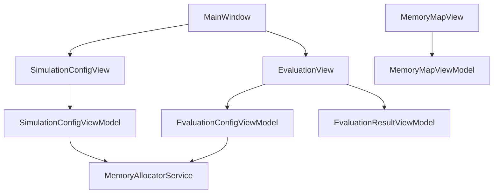

# OSMemoryAllocationSimulator
A desktop WPF application that visualises OS memory‑allocation algorithms (First‑Fit, Best‑Fit, Worst‑Fit) for teaching and research.


## Table of contents
- [Overview](#overview)
- [Tech stack](#tech-stack)
- [Setup](#setup)
- [Architecture](#architecture)
- [Roadmap](#roadmap)
- [Contributing](#contributing)

## Overview
The app lets students configure a memory size, choose a workload and run three classic allocation algorithms.
It visualises the memory map, fragmentation stats and produces CSV reports.

## Tech stack
- **Language**: C# 12
- **Framework**: .NET 8 (WPF)
- **Pattern**: MVVM (CommunityToolkit.Mvvm)
- **Charts**: LiveChartsCore.SkiaSharpView.WPF (placeholder)
- **CSV**: CsvHelper

## Setup
```bash
# Clone the repository
git clone https://github.com/VUTRUONG04/os-memory-allocation-simulator.git
cd os-memory-allocation-simulator

# Restore packages and build
dotnet restore
dotnet build

# Run the application
# From command line
dotnet run
# Or press F5 in Visual Studio
```

## Architecture


## Roadmap (4‑week sprint)
| Week | Goal |
|------|------|
| 1 | Complete UI layout (XAML) + shared resources |
| 2 | MVVM skeleton – ViewModels, DataBinding, Commands |
| 3 | Wire UI → Service (dummy data) + navigation |
| 4 | LiveCharts, CSV export, docs, final polish |

## Contributing
Please read our [CONTRIBUTING.md](CONTRIBUTING.md) for details on our development workflow and how to submit pull requests.